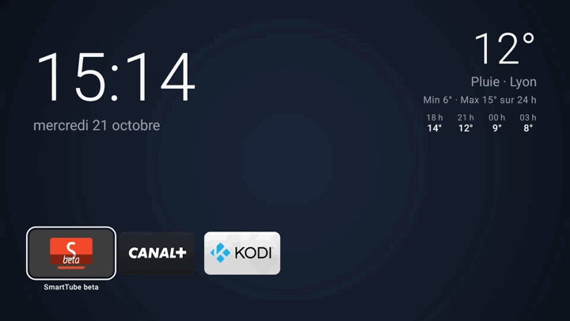
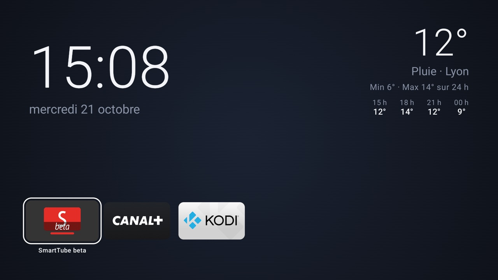
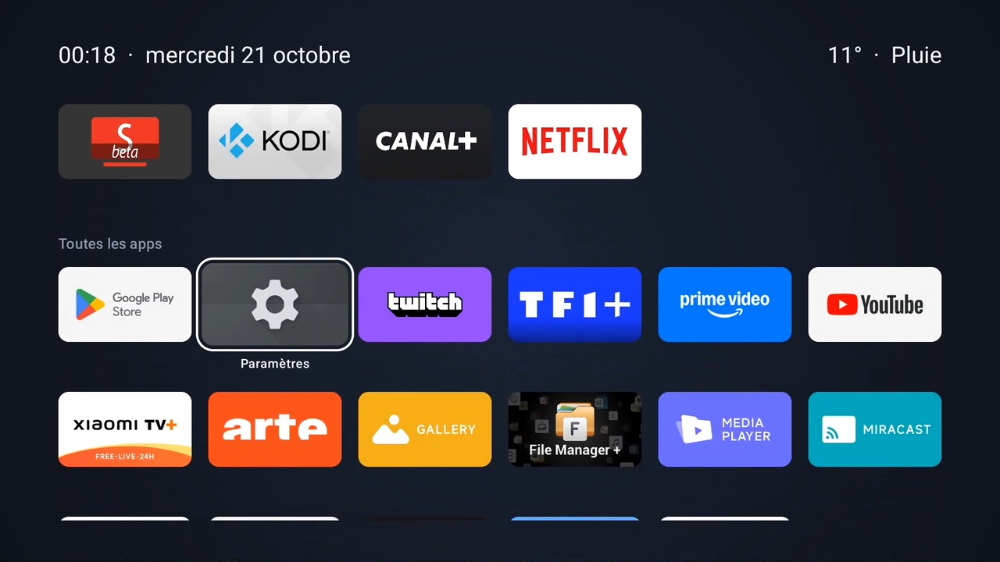
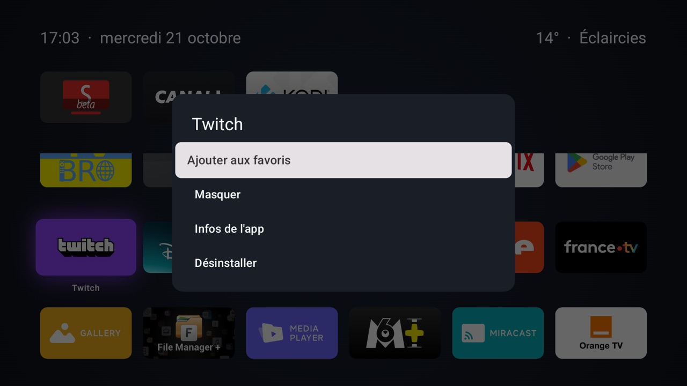
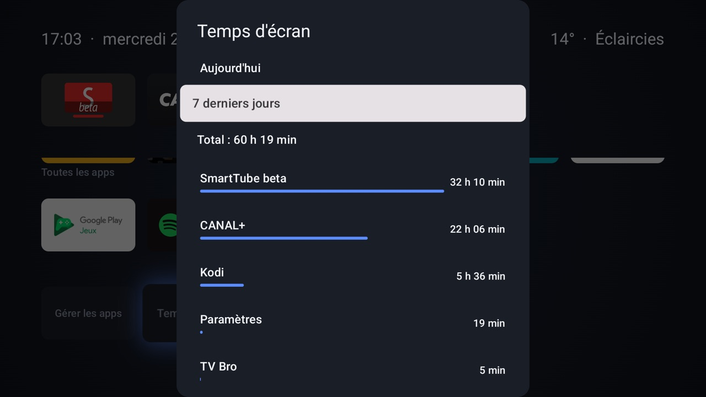
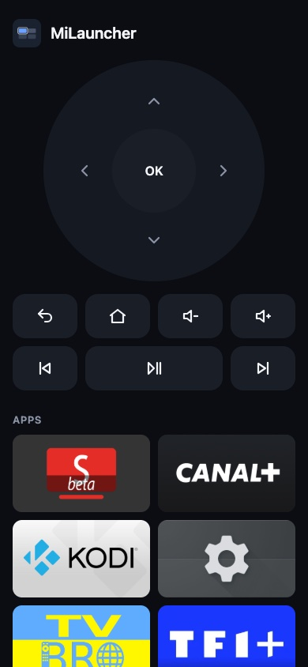
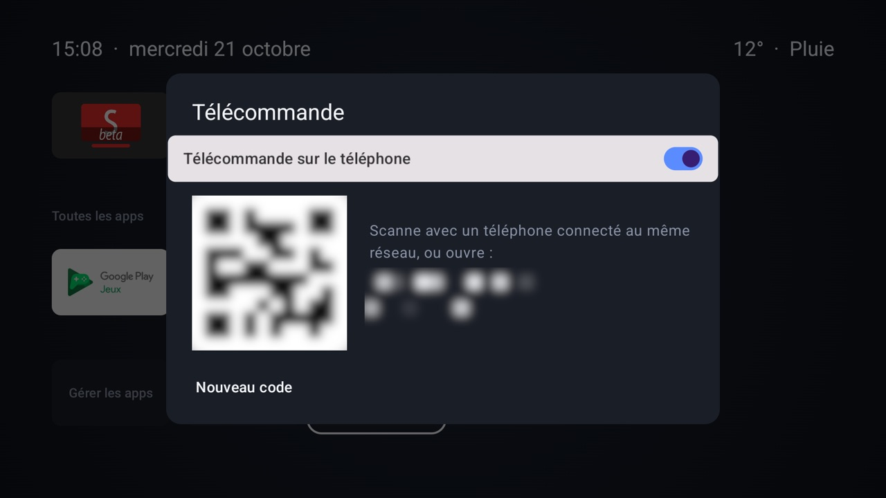

# MiLauncher

Launcher Android TV minimaliste, sans pub ni recommandations, conçu pour une Xiaomi Mi Box S (Google TV).
Kotlin, Jetpack Compose et [Compose for TV](https://developer.android.com/jetpack/androidx/releases/tv).



[Vidéo en qualité d'origine](docs/demo.mp4), filmée sur la box (l'enregistreur de la box saute les images
identiques, la vidéo est donc plus rapide que la réalité).

| Accueil | Vue étendue |
|---|---|
|  |  |

| Appui long sur une app | Temps d'écran |
|---|---|
|  |  |

| Télécommande sur le téléphone | Appairage depuis la TV |
|---|---|
|  |  |

- **Accueil** : grande horloge, météo détaillée (Open-Meteo, sans clé), temps d'écran de la semaine jour par jour
  et barre de 6 favoris en bas de l'écran. La tuile sélectionnée s'entoure d'un halo de la couleur de l'app,
  traversé d'un reflet.
- **Vue étendue** (flèche bas depuis la barre) : la page défile vers le haut, les widgets passent en version
  réduite, la barre remonte et toutes les apps apparaissent dessous.
  Flèche haut, Retour ou Home ramènent à l'accueil.
- **Appui long** sur une app : ajouter/retirer des favoris, réordonner, masquer, infos, désinstaller
  (apps installées par l'utilisateur, avec la confirmation d'Android).
- **Gérer les apps** : afficher ou masquer chaque app.
- **Temps d'écran** : temps passé dans chaque app aujourd'hui ou sur 7 jours, calculé sur la box.
- **Télécommande sur le téléphone** (désactivée par défaut) : une page web servie par la box sur le réseau local,
  appairée en scannant le QR code affiché sur la TV. Croix directionnelle et OK, Retour, Accueil, volume,
  précédent / lecture-pause / suivant, grille des apps avec leurs bannières, et ouverture d'un lien sur la TV.
  La page s'ajoute à l'écran d'accueil du téléphone comme une app.
- **Mises à jour** : le launcher vérifie la dernière release GitHub et propose de l'installer.
- Sans favoris, la barre affiche les apps les plus récemment utilisées.
- Interface en anglais et en français, selon la langue de la box ; l'heure suit le réglage 12 h / 24 h.

## Vie privée

Aucune pub, aucun compte, aucune statistique envoyée. Les seules requêtes réseau :

- [ipwho.is](https://ipwho.is) une fois, pour une position approximative mise en cache (aucune permission de
  localisation), puis [Open-Meteo](https://open-meteo.com) toutes les 30 minutes pour la météo ;
- l'API GitHub toutes les 12 heures, pour la dernière release du dépôt réglé par la propriété Gradle
  `milauncher.updateRepo`.

Le temps d'écran est calculé sur la box à partir des statistiques d'usage d'Android et n'en sort pas.
La télécommande écoute sur le port 8765, refuse toute adresse hors du réseau local, exige le code à 6 chiffres
à chaque appel et se bloque une minute après 5 codes faux ; le trafic n'est pas chiffré (HTTP sur le réseau local).
Le QR code place le code après le `#` de l'URL, partie qu'un navigateur n'envoie jamais au serveur ; la page le garde
dans le stockage local du téléphone puis l'efface de la barre d'adresse.

Faute de HTTPS sur le réseau local, Chrome ne propose pas l'installation automatiquement : la page affiche à la place
les gestes pour l'ajouter à l'écran d'accueil (et un bouton « Installer » si le navigateur le permet).
Le volume est celui de la box ; « précédent » et « suivant » sont les touches média, transmises à l'app qui joue.

## Permissions

Les fonctions qui en ont besoin proposent de les accorder depuis la TV ; les commandes adb font la même chose.

| Permission | Pour | Depuis la TV | Par adb |
|---|---|---|---|
| Accès aux données d'utilisation | apps récentes en premier, temps d'écran | Temps d'écran > « Autoriser l'accès aux données d'utilisation » | `adb shell appops set com.lilyan_lefevre.milauncher GET_USAGE_STATS allow` |
| Installation d'apps inconnues | mises à jour depuis le launcher | tuile « Mettre à jour » | `adb shell appops set com.lilyan_lefevre.milauncher REQUEST_INSTALL_PACKAGES allow` |
| Service d'accessibilité | flèches, OK et Retour de la télécommande | Télécommande > « Activer les flèches et OK », puis Accessibilité > Télécommande MiLauncher | voir ci-dessous |

Le service d'accessibilité est déclaré sans accès au contenu des fenêtres ni aux événements : il ne lit rien à l'écran
et n'exécute que les actions demandées par la télécommande. Android affiche malgré tout son avertissement générique.
Par adb, l'ajouter à la liste des services déjà actifs plutôt que de la remplacer :

```sh
SERVICE=com.lilyan_lefevre.milauncher/com.lilyan_lefevre.milauncher.remote.RemoteAccessibilityService
CURRENT=$(adb shell settings get secure enabled_accessibility_services)
[ "$CURRENT" = "null" ] || [ -z "$CURRENT" ] && NEW=$SERVICE || NEW="$CURRENT:$SERVICE"
adb shell settings put secure enabled_accessibility_services "$NEW"
adb shell settings put secure accessibility_enabled 1
```

## Installation

Télécharger l'APK de la dernière [release](../../releases/latest), ou le construire :

```sh
./gradlew assembleRelease
```

Puis l'installer sur la box :

```sh
adb connect <ip-de-la-box>:5555
adb install -r milauncher.apk
```

Puis accorder les [permissions](#permissions), depuis la TV ou par adb.

## Signature et CI

GitHub Actions (`.github/workflows/release.yml`) vérifie le style (ktlint), lance les tests et construit l'APK release
à chaque push.
L'APK est disponible dans les artefacts du run ; pousser un tag `v*` publie aussi une release GitHub.

L'APK est signé avec une clé de release fixe, fournie par ces secrets du dépôt :

| Secret | Contenu |
|---|---|
| `SIGNING_KEYSTORE_BASE64` | keystore encodé en base64 |
| `SIGNING_STORE_PASSWORD` | mot de passe du keystore |
| `SIGNING_KEY_ALIAS` | alias de la clé |
| `SIGNING_KEY_PASSWORD` | mot de passe de la clé |

En local, Gradle lit les variables `SIGNING_KEYSTORE` (chemin du fichier), `SIGNING_STORE_PASSWORD`,
`SIGNING_KEY_ALIAS` et `SIGNING_KEY_PASSWORD`. Sans elles, la release est signée avec la clé debug.

Android refuse de mettre à jour une app signée avec une autre clé : pour passer d'un build local signé en debug
à un APK de la CI, désinstaller d'abord l'app (`adb uninstall com.lilyan_lefevre.milauncher`), ce qui efface
les favoris, puis accorder de nouveau les [permissions](#permissions).

## En faire l'écran d'accueil

Google TV ne propose pas de choisir le launcher par défaut : il faut désactiver l'accueil d'origine
et l'app qui le réactive.

```sh
adb shell pm disable-user --user 0 com.google.android.apps.tv.launcherx
adb shell pm disable-user --user 0 com.google.android.tungsten.setupwraith
```

Pour revenir à l'accueil Google TV, remplacer `disable-user --user 0` par `enable`.
Une mise à jour système peut réactiver ces paquets : relancer alors les commandes ci-dessus.

## Contribuer

```sh
./gradlew testDebugUnitTest   # tests unitaires
./gradlew ktlintCheck         # style (règles dans .editorconfig), aussi vérifié par la CI
./gradlew ktlintFormat        # corrige le style automatiquement

# Une fois par clone : formate les fichiers Kotlin indexés avant chaque commit.
./gradlew addKtlintFormatGitPreCommitHook
```
